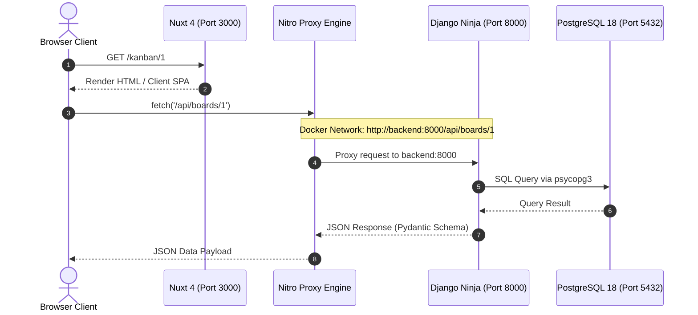

# Architecture & Domain

This section details the system architecture, container topology, network routing, and ubiquitous domain vocabulary of MeanTime.

---

## System Architecture

MeanTime is designed as a modular, decoupled full-stack application structured into three primary tiers:

```
                      +---------------------------------------+
                      |             Browser Client            |
                      +---------------------------------------+
                                          |
                        HTTP / Vite HMR   |  Port 3000
                                          v
                      +---------------------------------------+
                      |         frontend (Nuxt 4 / Vue 3)     |
                      |  - PrimeVue 5 + Tailwind CSS          |
                      |  - Nitro Engine API Proxy (/api/**)   |
                      +---------------------------------------+
                                          |
                        Internal Docker    |  http://backend:8000
                        Network Proxy      v
                      +---------------------------------------+
                      |       backend (Django Ninja / ASGI)   |
                      |  - Python 3.14 + Uvicorn              |
                      |  - Auto-generated OpenAPI / Swagger   |
                      +---------------------------------------+
                                          |
                          SQL / psycopg3   |  Port 5432
                                          v
                      +---------------------------------------+
                      |          db (PostgreSQL 18)           |
                      |  - Named volume persistence           |
                      +---------------------------------------+
```

### 1. Presentation Tier (Frontend)
- **Framework**: [Nuxt 4](https://nuxt.com/) running Vue 3, TypeScript, and Vite.
- **UI & Design**: [PrimeVue 5](https://primevue.org/) (Aura theme preset) paired with [Tailwind CSS 3.4](https://tailwindcss.com/) using defined CSS layer boundaries.
- **State**: [Pinia](https://pinia.vuejs.org/) modular stores.
- **Networking**: Centralized `ApiService` wrapper calling relative `/api/**` routes proxied by Nuxt's Nitro engine.

### 2. Application Tier (Backend)
- **Framework**: [Django 5.2+](https://docs.djangoproject.com/) with [Django Ninja 1.6+](https://django-ninja.dev/) for high-performance, asynchronous REST API endpoints with Pydantic validation.
- **Server**: [Uvicorn](https://www.uvicorn.org/) running in ASGI mode with `watchfiles` file-polling for live reloading.
- **Self-Documenting API**: Automatic OpenAPI 3 schema generation serving interactive Swagger UI and ReDoc interfaces.

### 3. Data Tier (Database)
- **Engine**: [PostgreSQL 18](https://www.postgresql.org/) (Alpine) managed via Docker Compose.
- **Driver**: `psycopg` (v3) providing native asynchronous and synchronous connection pooling.
- **Persistence**: Managed through Docker named volume `db_data`.

---

## Networking & Proxy Architecture

To eliminate Cross-Origin Resource Sharing (CORS) complexity during development and production, MeanTime routes all API interactions through Nuxt's server engine (Nitro):



1. The browser sends all requests to the same origin (`http://localhost:3000`).
2. Any request beginning with `/api/**` is intercepted by Nuxt's Nitro server proxy and transparently forwarded to `http://backend:8000/api/**` over the private Docker bridge network.
3. Cookies, headers, and authentication tokens flow seamlessly without custom CORS origin policies.

---

## Zero-Install Host IDE Synchronization

To ensure smooth developer experience without requiring Node, pnpm, or Python on the host machine:

- **Volume Isolation**: The frontend container uses an internal Linux named Docker volume (`frontend_node_modules`) for fast package resolution on native ext4 filesystem speeds.
- **Host Sync**: On container startup, an entrypoint script synchronizes package definitions and TypeScript declaration files back to `./frontend/node_modules` on the host using `rsync`.
- **IntelliSense**: VS Code, Cursor, and other IDEs immediately resolve TypeScript types, auto-imports, and component definitions directly on the host filesystem.

---

## Domain Concepts

MeanTime follows an established ubiquitous language for its core domain entities:

### Board
A workspace container organizing work items into sequential columns.  
*Avoid*: Kanban, dashboard.

### Column
A vertical stage on a board representing the status or progress of tasks.  
*Avoid*: Lane, status bucket, list.

### Task
An individual unit of work tracked within a column.  
*Avoid*: Card, ticket, issue, item.

### Title
The descriptive name identifying a board, column, or task.  
*Avoid*: Name, label, headline.

### Position
The zero-indexed numerical placement of a column across a board or a task within a column.  
*Avoid*: Order, rank, sequence, index.
